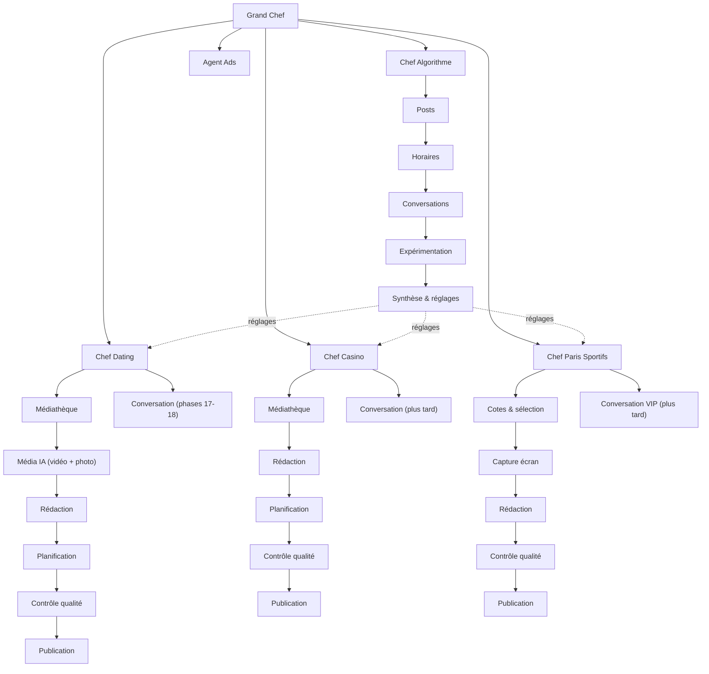

<!-- Copie de référence du document « Architecture — Équipe d'agents IA » (Claude Docs, version du 23 octobre 2026,
     validée par le client). C'est LA référence des phases 19 à 25 (docs/prompts/21-… à 27-…). En cas de doute entre
     ce fichier et un prompt de phase, le prompt de phase l'emporte (il est plus précis) ; en cas de doute entre ce
     fichier et docs/02-decisions.md ou CLAUDE.md, CLAUDE.md et 02-decisions.md l'emportent. Adresse du document
     d'origine : https://claude.ai/artifact/KBUe25k2cSsfeArSzfpBfQ -->

# Architecture — Équipe d'agents IA autonomes

2026-10-23 · @matheo

Ce plan décrit l'organisation complète d'une équipe d'agents IA (un Grand Chef, quatre Chefs d'équipe : Dating, Casino, Paris sportifs, Algorithme ; un agent par action) intégrée à la plateforme LinkAffiPro existante, et la façon dont elle sera construite en autonomie. Priorité : Dating d'abord, puis Algorithme, Casino, Paris sportifs, Ads. Version revue et optimisée le 23 octobre 2026, équipe Algorithme ajoutée le même jour.

## Contrôle complet du 23 octobre : ce qui a été optimisé

- **Demandes par ton bot Telegram** (ta demande du 23 octobre, 14 h) : clés, identifiants, choix et vidéos te sont demandés par le bot, une question à la fois, et tu réponds au message ; clés rangées chiffrées, jamais réaffichées, message supprimé aussitôt, vérification immédiate. Le site reste possible en secours.
- **Nouvelle équipe Algorithme** (ta demande de 13 h 30) : un Chef Algorithme et 5 agents (Posts, Horaires, Conversations, Expérimentation, Synthèse & réglages) qui mesurent ce qui marche (types de posts, horaires, conversations de chaque profil) et règlent les autres équipes, dans des bornes et avec annulation en un clic. Section « Chef Algorithme » et phase 21 ajoutées.
- **Le Grand Chef et les Chefs sont de la logique programmée** (fiable, gratuite, testable). L'IA n'intervient que là où elle apporte quelque chose : rédiger, juger la qualité, analyser les pubs, converser. Les agents ne « discutent » pas entre eux : ils se passent des fiches de mission structurées.
- **Un agent Contrôle qualité dans chaque équipe**, juste avant la publication : c'est lui qui rend possible l'autonomie à 99 % sans risque (texte, média, doublons, cote, règles).
- **Vidéos Dating : remplacement de la personne entière** (Wan 2.2 Animate « replace »), pas seulement du visage. Coût réel : 1 à 2 € par vidéo, donc budget plafonné et réglable. Ajout des **photos IA** faites avec ton LoRA (quelques centimes) pour varier sans faire exploser le budget.
- **Médiathèque sans serveur de stockage** : vidéos et photos rangées dans un canal Telegram privé (gratuit, illimité, republication instantanée). Tu fournis une vidéo en la transférant au bot.
- **Quatre métiers communs** (Rédaction, Planification, Contrôle qualité, Publication) écrits une seule fois et réglés par équipe : moins de code, moins de bugs. L'« Agent Contenu partagé » disparaît (doublon).
- **Niveaux d'autonomie réglables par équipe** (0 : je valide tout ; 1 : je valide les nouveautés ; 2 : autonomie totale avec rapport), bouton Pause, plafonds de dépense mensuels, mode simulation sur le canal Test tant que tu n'as pas basculé une équipe.
- **Missions reprenables** : si le serveur redémarre au milieu d'une chaîne, elle reprend à l'étape suivante ; rien n'est publié deux fois.
- **Plan de développement calé sur la chaîne autonome existante** (phases 19 à 25, lancées par une seule commande, un message Telegram à la fin de chaque phase). Ordre corrigé : Casino et Paris sportifs étaient inversés dans l'ancien plan.
- **Liste précise du 1 % qui te revient** (clés à coller, vidéos à envoyer, compte bookmaker) et **tableau des risques** avec leur parade.

## Vue d'ensemble

L'organisation suit une hiérarchie claire : un **Grand Chef** supervise 4 **Chefs d'équipe** (Dating, Casino, Paris Sportifs, Algorithme), chacun pilotant un agent par action. Les trois premières équipes produisent et publient ; l'équipe **Algorithme** mesure ce qui marche (posts, horaires, conversations de chaque profil) et règle les trois autres. L'**Agent Ads** dépend directement du Grand Chef et analyse les pubs de tous les univers. Règle d'or : le Grand Chef et les Chefs sont de la logique programmée ; l'IA n'est appelée que pour rédiger, juger la qualité, analyser et converser.

## Hiérarchie complète des agents

### Grand Chef (direction)

Logique programmée, cycle toutes les 30 minutes et à la demande. Il : (1) fixe le plan du jour par équipe et par canal (combien de publications, dans quelle fenêtre horaire) selon tes réglages et les réglages recommandés par l'équipe Algorithme ; (2) tient les budgets (vidéo IA, IA de rédaction, API de cotes) et refuse toute mission qui dépasserait le plafond du mois ; (3) empêche les collisions (deux publications trop proches sur un même canal, une même vidéo réutilisée trop tôt) ; (4) applique le niveau d'autonomie de chaque équipe et t'envoie les demandes de validation ; (5) met une équipe en pause après 3 échecs de suite et t'alerte ; (6) envoie le rapport quotidien (une ligne par équipe : publié, en attente, refusé, dépense) ; (7) reçoit chaque semaine les réglages de l'équipe Algorithme et les applique, dans les bornes, selon le niveau d'autonomie.

### Chefs d'équipe (un par univers)

Chaque Chef transforme le plan du jour en **missions** (une mission = une publication à produire). Il fait passer chaque mission par ses agents dans l'ordre, enregistre l'état après chaque étape (reprenable après un redémarrage, jamais de double publication), réessaie une fois en cas d'erreur, puis remonte le résultat au Grand Chef.

| Chef | Chaîne de production | En parallèle |
|---|---|---|
| Chef Dating | Médiathèque → Média IA → Rédaction → Planification → Contrôle qualité → Publication | Conversation (déjà en place, phases 17-18) |
| Chef Casino | Médiathèque → Rédaction → Planification → Contrôle qualité → Publication | Conversation (phase ultérieure) |
| Chef Paris Sportifs | Cotes & sélection → Capture écran → Rédaction → Contrôle qualité → Publication | Conversation VIP (phase ultérieure) |
| Chef Algorithme | Posts → Horaires → Conversations → Expérimentation → Synthèse & réglages (ne publie rien : mesure et règle les trois autres équipes) | Alertes de décrochage (en continu) |

### Les agents (un par action)

Quatre métiers sont communs aux trois équipes : **même code, réglages différents par équipe** (la « fiche de poste » change : ton, règles, canaux ; pas le moteur).

| Agent | Équipes | Ce qu'il fait | IA ? |
|---|---|---|---|
| Médiathèque | Dating, Casino | Range les vidéos et photos (par équipe, thème, persona) dans le canal Telegram privé « Médiathèque », note chaque utilisation par canal, choisit le prochain média non utilisé, détecte les manques et te demande des vidéos. Une vidéo transférée au bot avec un mot-clé (#casino #roulette) est rangée toute seule. | Non |
| Média IA | Dating | Vidéo : remplace la personne de la vidéo source par ton personnage (image de référence issue de ton LoRA) via Wan 2.2 Animate « replace » (fal.ai), Magic Hour en repli. Photo : génère des photos de ton personnage avec ton LoRA. Sans clé saisie : mode simulation. | Oui (vidéo, photo) |
| Rédaction | Toutes | Écrit la légende : très courte, style Telegram, « humaine », adaptée au canal et à la persona ; reçoit ce qui a déjà été dit sur ce canal pour ne pas se répéter ; jamais de mention d'IA. | Oui (Claude) |
| Cotes & sélection | Paris | Interroge l'API de cotes (matchs à 24-48 h, ligues réglées), filtre par catégorie (tirs cadrés, corners…), classe par intérêt (écart de cote entre bookmakers, moyennes des équipes), retient les N meilleurs, évite les doublons. | Règles ; IA pour le raisonnement court |
| Capture écran | Paris | Ouvre le site du bookmaker (Playwright, compte connecté), retrouve le pari, vérifie que la cote est encore là, fait la capture (cote entourée). | Non |
| Planification | Dating, Casino | Choisit le créneau : quota du canal, fenêtres horaires et mélange fournis par l'équipe Algorithme, espacement minimal, heures calmes, pas de collision. Pour Paris : publication immédiate, avant le match. | Non |
| Contrôle qualité | Toutes | Dernier filtre avant publication : règles (longueur, mots interdits, liens, aucune mention d'IA), doublon avec les 30 derniers posts, média valide (durée, taille ; pour une vidéo IA, 3 images regardées par l'IA pour repérer un défaut visible), pour Paris : cote re-vérifiée. Verdict : publier, refaire (une fois) ou demander à un humain. | Oui (jugement) |
| Publication | Toutes | Crée le message programmé dans la plateforme, qui part par le bot ou par le compte connecté (emojis animés) ; confirme l'envoi ; relève ensuite vues et clics pour apprendre. | Non |
| Conversation | Dating (en place), Casino et Paris (plus tard) | Dating : moteur de conversation et comptes des phases 17-18, réutilisés tels quels. Casino et Paris : réponses aux questions courantes et lien VIP, passage à un humain hors périmètre. | Oui (Venice) |
| Ads | Grand Chef | Lit Meta et TikTok (connecteurs) et les statistiques LinkAffiPro, produit chaque jour des recommandations classées (arrêter, augmenter, tester, surveiller) avec les chiffres qui les justifient ; ne touche jamais aux plateformes pub. | Oui (analyse) |
| Posts | Algorithme | Pour chaque post, une fiche de résultats (vues à 1 h et à 24 h, réactions, clics sur l'offre, inscriptions, dépôts) croisée avec ses caractéristiques (type vidéo / photo / texte, thème, persona, canal, longueur, emojis, heure, jour, bouton). Classe ce qui marche et ce qui ne marche pas, par canal et par univers. | Non (calculs) |
| Horaires | Algorithme | Fenêtres de publication par canal, par type de post et par jour de la semaine (vues des 2 premières heures, taux de clic) ; meilleures heures pour les relances des conversations. Remplace le calcul actuel des meilleurs horaires. | Non (calculs) |
| Conversations | Algorithme | Pour chaque profil (bot ou compte réel, persona) : taux de réponse, messages avant le lien, étape où les gens décrochent, heures de réponse, coût par inscription. L'IA relit un échantillon d'échanges pour repérer les accroches qui obtiennent une réponse et celles qui font fuir, et propose des réglages de persona. | Oui (relecture) |
| Expérimentation | Algorithme | Monte des tests A/B propres (deux styles de légende, deux heures, deux mélanges, deux réglages de persona) avec le mécanisme A/B existant, attend assez de données, mesure, déclare un gagnant ou « pas de différence ». | Non (statistiques) |
| Synthèse & réglages | Algorithme | Transforme les analyses en réglages concrets par équipe et par canal (mélange photo / vidéo / texte, fenêtres horaires, quotas, consignes de style pour la Rédaction, réglages de persona), chacun avec les chiffres qui le justifient et le gain attendu ; rapport hebdomadaire « Ce qui marche ». | Oui (rapport) |

## Chef Dating : workflow de l'équipe

Le **Chef Dating** coordonne ses 5 agents dans l'ordre du pipeline. Il reçoit du Grand Chef le nombre de publications demandées et les canaux concernés, puis déclenche la chaîne : Face Swap → Rédaction → Planification → Publication. L'agent Conversation tourne en parallèle, en continu.

### Ce qui existe déjà

- **Moteur de conversation** (packages/chat) : parcours, relances, détection des mineurs, liens d'offre, 6 langues.
- **Userbots** (apps/userbot) : comptes Telegram réels par persona, messages privés via GramJS.
- **Personas** (modèle Persona) : profil, style, photo, configurables depuis le site.
- **Publication** : création de posts, programmation, modèles par univers, emojis animés, publication par compte connecté.
- **Suivi** : liens trackés, sub-IDs, attribution pub → membre → joueur.

### Ce qui est ajouté

- **Média IA** : remplacement de la personne entière d'une vidéo source (10-15 s) par ton personnage, à partir d'une image de référence générée avec ton LoRA ; photos IA du même personnage pour les posts photo. Fournisseur principal : Wan 2.2 Animate « replace » sur fal.ai (1 à 2 € par vidéo de 10-15 s en 720p) ; repli : Magic Hour (visage seulement, ~0,15 €). Les 3 premières vidéos de chaque persona passent par toi, quel que soit le niveau d'autonomie.
- **Médiathèque** : vidéos sources et médias générés rangés dans le canal Telegram privé « Médiathèque », indexés par persona et par thème, avec l'historique d'utilisation par canal ; alerte quand il reste moins de 3 vidéos sources non utilisées.
- **Rédaction** : légende très courte et naturelle, dans le style de la persona (exemples de style de la fiche persona), sans répéter les 30 derniers posts du canal.
- **Planification** : nombre de posts par jour réglable par canal (3-4 par défaut), meilleurs horaires déjà calculés, mélange réglable photo / vidéo / texte (par défaut : 1 vidéo, 2 photos, 1 texte).

### Cycle quotidien

1. Le Grand Chef donne au Chef Dating le plan du jour (par canal : nombre de posts, fenêtre horaire, budget restant).
2. Le Chef crée une mission par post et la lance : Médiathèque choisit la vidéo source non utilisée (ou décide d'un post photo ou texte selon le mélange réglé).
3. Média IA produit la vidéo (tâche asynchrone de 2 à 5 minutes, résultat récupéré par webhook ou relance) ou la photo ; le coût est enregistré.
4. Rédaction écrit la légende ; Planification fixe l'heure.
5. Contrôle qualité vérifie texte et média ; s'il doute, la mission part en validation (aperçu Telegram + boutons).
6. Publication crée le message programmé ; le worker existant l'envoie à l'heure prévue ; vues et clics sont relevés le lendemain.
7. En cas d'erreur (fournisseur vidéo en panne, budget atteint) : la mission est reportée, le Chef bascule sur un post photo ou texte pour tenir le quota, le Grand Chef est prévenu.

### Validation humaine

Selon le niveau d'autonomie de l'équipe (voir « Niveaux d'autonomie et garde-fous »). Toujours validés, quel que soit le niveau : une nouvelle persona, les 3 premières vidéos d'une persona, un nouveau canal. En mode simulation (par défaut), rien ne part sur un vrai canal : tout va sur le canal Test.

## Chef Paris Sportifs : workflow de l'équipe

Le **Chef**** Paris Sportifs** coordonne ses 5 agents. Il reçoit du Grand Chef les catégories de paris à couvrir et les bookmakers cibles, puis déclenche : Cotes/Sélection → Capture écran → Rédaction → Publication. L'agent Conversation tourne en parallèle pour gérer les demandes VIP.

### Sources de données

- **API de cotes** : SportsGameOdds (80+ bookmakers, cotes en direct, tirs cadrés, corners, cartons, paris joueurs, grandes ligues de football) en principal ; OddsPapi (Sportaza listé, 250 requêtes par mois gratuites) en complément. Elles servent à trouver et classer les paris.
- **Site du bookmaker partenaire** (Sportaza…) : le pari retenu y est retrouvé, sa cote vérifiée et la capture faite par un navigateur piloté (Playwright, compte connecté). La cote publiée est donc toujours celle du bookmaker, même s'il n'est pas dans l'API.
- **Résultats** : l'API fournit les scores et statistiques après le match ; chaque pari publié est marqué gagné ou perdu.

### Catégories de paris configurées

Chaque catégorie (tirs cadrés, corners, buts, cartons, paris joueurs…) est définie dans les réglages avec :

- Le type de marché à rechercher (identifiant API).
- Les critères de sélection : cote minimale/maximale, ligues couvertes, bookmakers concernés.
- Le nombre de paris à publier par jour.
- Le ou les canaux Telegram de destination.

### Cycle de publication

1. Le Grand Chef déclenche le Chef Paris Sportifs (2-3 fois par jour, et 2 h avant les matchs du soir) avec les catégories et le nombre de paris du jour.
2. Cotes & sélection interroge l'API de cotes pour les matchs à venir (24-48 h) dans les ligues réglées.
3. Pour chaque catégorie, il filtre les paris selon les critères et les classe par intérêt (écart de cote entre bookmakers, moyennes des équipes, historique du marché).
4. Il retient les N meilleurs paris et écarte ce qui a déjà été publié.
5. Pour chaque pari retenu : capture d'écran du site bookmaker (Playwright, compte connecté) après vérification que la cote est encore là ; si elle a bougé au-delà de l'écart réglé, le pari est écarté.
6. Rédaction écrit le post (match, marché, cote, une ou deux phrases de raisonnement, bouton d'offre) ; Contrôle qualité re-vérifie la cote et le texte juste avant l'envoi.
7. Publication envoie tout de suite (un pari ne se programme pas pour plus tard). Après le match, le résultat (gagné ou perdu) est enregistré : la rubrique Agents affiche le bilan par catégorie et par ligue.

### Méthodologie de sélection

L'agent ne prédit pas les résultats. Il identifie des paris dont la cote semble sous-évaluée par rapport aux statistiques historiques (données de l'API : moyennes par équipe, confrontations directes). La logique de sélection est entièrement configurable et transparente : chaque publication affiche le raisonnement.

### Validation humaine

Mêmes niveaux d'autonomie que les autres équipes. Toujours validés : une ligue ou un marché jamais utilisés, une cote hors de la fourchette réglée. Si le site du bookmaker refuse le robot (protection anti-robot ou blocage géographique depuis le serveur), parade dans l'ordre : adresse IP résidentielle (10-30 € par mois), puis capture faite depuis ton Mac, et en dernier recours une image fabriquée par nous à la place de la capture.

## Chef Casino : workflow de l'équipe

Le **Chef Casino** coordonne ses 5 agents. Il reçoit du Grand Chef le calendrier promotionnel et les canaux actifs, puis déclenche : Bibliothèque (vérifier le stock) → Rédaction → Planification → Publication. L'agent Conversation tourne en parallèle.

### Ce qui existe déjà

- **Publication et programmation** : création de posts, modèles par univers casino, horaires optimaux, emojis animés.
- **Offres et suivi** : bouton Offre lié à la campagne, liens trackés, sub-IDs, attribution complète.
- **Conversation** : le moteur packages/chat et les userbots répondent déjà aux messages privés des membres casino.
- **Relances automatiques** : parcours graphe, relances configurées par canal.

### Ce qui est ajouté

- **Médiathèque** : indexation des vidéos que tu fournis (transfert au bot avec un mot-clé), par thème (machines à sous, roulette, bonus, jackpot…), suivi des utilisations par canal, demande groupée quand un thème passe sous 3 vidéos non utilisées. **Règle absolue : aucune vidéo inventée ou générée** ; l'équipe Casino n'utilise que ce que tu as fourni.
- **Planification** : calendrier qui croise les meilleurs horaires, le type de contenu (vidéo, image, texte), le thème du jour et les résultats passés (vues et clics par type de post).
- **Rédaction** : légende courte, ton du canal et offre du moment (bonus, cashback, tournoi), sans répétition.

### Cycle quotidien

1. Le Grand Chef donne au Chef Casino le plan du jour par canal.
2. Médiathèque choisit le média (vidéo non utilisée du bon thème) ou signale le manque.
3. Rédaction écrit la légende ; Planification fixe l'heure.
4. Contrôle qualité vérifie ; validation si besoin.
5. Publication programme le message ; le worker l'envoie.
6. Vidéo manquante : la mission bascule en post texte ou image (modèles existants) pour tenir le quota, et une demande de vidéos t'est envoyée.

### Demande de vidéos

Quand un thème passe sous 3 vidéos non utilisées, un seul message Telegram groupé te dit le thème, le nombre souhaité et le canal concerné. Tu réponds en transférant les vidéos au bot avec le mot-clé indiqué (par exemple « #casino #roulette ») : elles sont rangées et utilisables tout de suite, sans passer par le site.

### Validation humaine

Mêmes niveaux d'autonomie. Toujours validés : un nouveau canal, un nouveau thème, une offre jamais utilisée.

## Chef Algorithme : workflow de l'équipe

Le **Chef Algorithme** ne publie rien : il mesure ce qui marche et règle les trois autres équipes. Chaque jour, il fait tourner ses agents sur les données déjà présentes dans la plateforme (posts, vues, réactions, clics, inscriptions, dépôts, conversations) et transmet au Grand Chef des réglages concrets par équipe et par canal. Il travaille dès le premier jour sur l'historique existant, avant même que les autres équipes publient.

### Ce qui existe déjà

- Meilleurs horaires par canal (calculés chaque nuit), tests A/B des messages de canal, vues Telegram relevées toutes les 15 minutes, statistiques par message, par canal, par pub et par joueur, attribution complète jusqu'au dépôt.
- Chiffres des conversations (phase 17) : par persona et par source, conversations, réponses, liens envoyés, clics, inscriptions, premiers dépôts, coût de l'IA, parcours par étape.

### Ce qui est ajouté

- **Agent Posts** : pour chaque post, une fiche de résultats (vues à 1 h et à 24 h, réactions, clics sur l'offre, inscriptions, dépôts) croisée avec ses caractéristiques (type vidéo / photo / texte, thème, persona, canal, longueur, emojis, heure, jour, bouton, modèle). Il classe ce qui marche et ce qui ne marche pas, par canal et par univers.
- **Agent Horaires** : fenêtres de publication par canal, par type de post et par jour de la semaine (vues des 2 premières heures, taux de clic) ; meilleures heures pour les relances des conversations ; remplace le calcul actuel des meilleurs horaires.
- **Agent Conversations** : pour chaque profil (bot ou compte réel, persona) : taux de réponse, nombre de messages avant le lien, étape où les gens décrochent, heures de réponse, coût par inscription ; l'IA relit un échantillon d'échanges pour repérer les accroches et tournures qui obtiennent une réponse et celles qui font fuir ; propose des réglages de persona (exemples de style, nombre d'échanges avant le lien, relances).
- **Agent Expérimentation** : monte des tests A/B propres (deux styles de légende, deux heures, deux mélanges, deux réglages de persona), s'appuie sur le mécanisme A/B existant, attend assez de données, mesure, déclare un gagnant ou « pas de différence ».
- **Agent Synthèse & réglages** : transforme tout cela en réglages concrets par équipe et par canal (mélange photo / vidéo / texte, fenêtres horaires, quotas, consignes de style pour la Rédaction, réglages de persona), chacun avec les chiffres qui le justifient et le gain attendu ; rapport hebdomadaire « Ce qui marche » par Telegram et page du même nom dans la rubrique Agents.

### Cycle

1. Chaque nuit : Posts, Horaires et Conversations recalculent leurs fiches sur les dernières 24 h et les 30 derniers jours.
2. Chaque lundi : Expérimentation clôt les tests arrivés à terme et en propose de nouveaux ; Synthèse produit les réglages de la semaine et le rapport.
3. Le Grand Chef applique les réglages selon le niveau d'autonomie de l'équipe Algorithme, puis les transmet aux Chefs : Planification et Rédaction les lisent au prochain plan du jour.
4. À tout moment : une alerte si un canal décroche (vues ou clics en baisse de plus de 30 % sur 7 jours) ou si un profil de conversation ne convertit plus.

### Garde-fous

- Aucune conclusion sans assez de données : au moins 20 posts (ou 1 000 vues) par cas comparé, au moins 30 conversations par profil ; sinon « pas encore assez de données », et un test A/B est proposé à la place.
- Réglages bornés : un mélange ne bouge pas de plus de 20 points par semaine, une fenêtre horaire reste dans les heures autorisées du canal, les quotas restent sous le maximum que tu as fixé ; les règles de contenu, de rythme et l'identité des personas ne sont jamais touchées.
- Chaque réglage appliqué est journalisé, visible dans la rubrique Agents, et annulable en un clic (retour au réglage précédent).

### Validation humaine

Niveau 0 : tout est proposé, rien n'est appliqué sans toi. Niveau 1 (conseillé) : les petits réglages (horaires, mélange) s'appliquent seuls ; les changements de persona et de quotas te sont proposés. Niveau 2 : tout s'applique dans les bornes, avec le rapport hebdomadaire.

## Agent Ads : workflow (rattaché au Grand Chef)

L'**Agent Ads** est directement rattaché au Grand Chef, pas à un Chef d'équipe, car il analyse les performances de toutes les équipes. Le Grand Chef le déclenche quotidiennement et lui transmet les données des 3 univers.

### Données disponibles

- **Connecteurs existants** (packages/connectors) : Meta et TikTok déjà intégrés. Les dépenses, impressions, clics, CPM, CPC et conversions sont synchronisés automatiquement (3 jours chaque heure, 28 jours la nuit, 90 jours à la connexion).
- **Statistiques plateforme** : DailyStat par campagne, pub, canal. Commissions (CPA + revshare), retour sur dépense pub, coût par membre, coût par inscription, gains nets.
- **Attribution complète** : pub → lien goolink → membre Telegram → clic offre → sub-ID → inscription → dépôt → joueur.

### Analyses réalisées

L'agent produit des rapports réguliers (quotidien, hebdomadaire) et des alertes en temps réel :

- **Performance par campagne** : dépense, membres acquis, inscriptions, dépôts, commissions, retour sur dépense. Comparaison avec la période précédente.
- **Performance par pub** : quelle créative fonctionne le mieux, quel texte, quelle audience. Identification des meilleures et des pires.
- **Entonnoir complet** : impression → clic pub → visite page → entrée Telegram → clic offre → inscription → dépôt. Taux de conversion à chaque étape, goulots d'étranglement.
- **Coût par résultat** : CPA réel (dépense ÷ dépôts), cohortes (combien rapportent les joueurs acquis il y a 7, 14, 30 jours).
- **Alertes** : dépense anormale, chute de conversions, pub à arrêter d'urgence, budget épuisé.

### Recommandations

L'agent ne se contente pas d'afficher des chiffres. Il propose des actions classées par priorité :

- **Arrêter** : pubs dont le coût par résultat dépasse le seuil depuis X jours.
- **Augmenter** : pubs rentables avec marge de progression (budget non épuisé, audience non saturée).
- **Tester** : nouvelles variations suggérées (texte, audience, placement) basées sur ce qui marche.
- **Surveiller** : pubs récentes ou en phase de test, pas encore assez de données.

Chaque recommandation est accompagnée des données qui la justifient.

### Livraison

Les rapports sont envoyés par Telegram (résumé + lien vers le détail sur la plateforme). Les alertes urgentes arrivent immédiatement. Les rapports complets sont accessibles dans la rubrique Statistiques du site.

### Validation humaine

L'agent recommande, il n'agit pas sur les plateformes publicitaires (pas de modification de budget ou d'arrêt automatique de pub). Chaque recommandation est un conseil que l'équipe applique ou non.

## Ordres de Kevin (phase 33)

Depuis la phase 33, une demande libre de l'admin à une équipe (« sur le canal de test faisons comme si c'était un canal Paris sportifs, programme les paris pour 3 jours, avec comme thème les hors-jeux ») devient un **ordre** (`TeamOrder`, numéro court « ordre n°12 ») au lieu d'un « je ne sais pas encore faire ça ». Contrat figé : `packages/agents/src/orders/contract.ts`.

### La chaîne (aucun raccourci)

admin → **Kevin** (`boss/`, outil `ordre_equipe`) → **planificateur** (`orders/planner.ts` : plan JSON strict à partir du contexte réel fourni par le code) → **validation par le code** (`orders/validate.ts` : chaque étape ↔ une capacité du registre, `parse` + `check` + bornes + chevauchement) → **récapitulatif** (`orders/recap.ts`, 3 lignes) et confirmation (OUI pour un vrai canal, le mode vrai, une dépense ou plus de 7 jours ; lancement immédiat avec « annule » pendant 60 s pour le canal Test en simulation) → **Grand Chef** (`orders/run.ts`) → **Chef de l'équipe** (capacité) → **agents** → Chef → Grand Chef (tâche `orders-tick`, événements `agents.order.<started|day_done|finished|failures|blocked>`) → **Kevin** (rapports au lancement, un par jour, bilan de fin). Aucun agent ne reçoit d'ordre directement : « dis à l'agent Rédaction d'écrire plus court » passe par son Chef (annuaire `orders/agents-dict.ts`).

### Registre des capacités

Une capacité = ce qu'une équipe sait faire, **déclaré en code** (`orders/capabilities/<équipe>.ts`, registre `orders/registry.ts` : `listCapabilities()`, `capability(équipe, clé)`) : `teamKey`, `key`, une description en français (montrée à l'IA et à l'écran), les agents concernés, un schéma strict des paramètres + `parse`, des bornes (`maxDays`, `maxPerDay`, canaux `any` / `team` / `test`, modes), puis `check` (le réel : thème ↔ marché, persona, stock de médias), `plan` (ce qui sera créé, **sans rien écrire**), `run` (écrit, idempotent par `(orderId, stepKey)`, reprenable après un arrêt) et `report` (les chiffres des messages de Kevin, seule source de chiffres). Une équipe absente du registre n'est pas « ordonnable » : Kevin le dit et note la demande (`BossUnmet.teamKey`, `suggestedCapability`), visible dans Agents → Kevin → « Pas encore possible ». Ce qui est impossible est toujours nommé avec sa raison et 2 à 4 replis numérotés (`ImpossiblePart`, gardés dans `TeamOrder.impossible`).

### Dérogations datées

Un ordre ne modifie jamais le plan d'un canal (`ChannelAgentPlan`) : il pose une **dérogation** (`ChannelPlanOverride` : équipe, jours de Paris `fromDay` → `toDay`, quantité, catégorie de paris, thèmes, mélange, format, fenêtre, persona, `isTest`), lue par `orchestrator/plan-day.ts` **avant** le plan. Elle s'éteint seule après `toDay` ou est close (`closedAt`) quand l'ordre est arrêté ; le plan de base reprend. « Faire comme si » n'existe que sur le canal Test (simulation forcée). Les missions créées portent `AgentMission.orderId` ; une catégorie de paris créée pour un ordre (`BetCategory.createdByOrderId`, `expiresAt`) redevient inactive à la fin. Site : Agents → **Ordres** (`/agents/orders`, fiche `/agents/orders/<id>` : demande, récapitulatif, plan en mots, impossibles, missions, dérogation appelée « réglage temporaire » à l'écran, chronologie, Arrêter / Prolonger pour les ADMIN, `AuditLog` `agents.order_stopped` / `agents.order_extended`) et encart « Réglage temporaire en cours jusqu'au … (ordre n°…) » sur la fiche du canal.

### Brancher une nouvelle équipe (phases 28 à 32)

1. Ajouter la clé d'équipe à `OrderTeamKey` (contrat) et son nom affiché (site : `ORDER_TEAMS` / `orderTeamName` dans `apps/web/lib/agents/orders.ts`).
2. Déclarer ses capacités dans `orders/capabilities/<équipe>.ts` à partir de fonctions **existantes** de l'équipe (aucune production cachée dans une capacité), avec leurs bornes et leurs agents, et les inscrire au registre.
3. Ajouter ses agents à l'annuaire (`orders/agents-dict.ts`) avec leurs synonymes en français courant.
4. Tests : un test par branche de `check` (ok, raison, replis), un test de `plan` sans écriture, `run` idempotent ; le test du registre vérifie que chaque capacité a description, schéma, `check`, `plan`, `run` et `report`.
5. Kevin, le planificateur, la validation, les rapports, la page Ordres et la fiche canal n'ont rien à changer : ils lisent le registre. Les demandes déjà notées dans « Pas encore possible » pour cette équipe disent quelles capacités déclarer d'abord.

## Niveaux d'autonomie et garde-fous

Le niveau se règle par équipe, dans Réglages → Agents, et se change à tout moment.

| Niveau | Ce que tu fais | Quand l'utiliser |
|---|---|---|
| 0 — Je valide tout | Chaque publication arrive sur Telegram avec un aperçu et des boutons ✅ Publier / ✏️ Corriger / ❌ Refuser | Démarrage d'une équipe (premiers jours) |
| 1 — Je valide les nouveautés | Seules les nouveautés passent par toi (nouvelle persona, nouveau canal, nouveau thème, nouveau marché, doute du Contrôle qualité) ; la routine part toute seule | Régime normal, conseillé |
| 2 — Autonomie totale | Rien à valider ; rapport quotidien ; tu peux supprimer un post publié en un clic | Quand l'équipe a fait ses preuves |

Garde-fous toujours actifs, quel que soit le niveau :

- **Mode simulation** par équipe (actif par défaut) : tout part sur le canal Test ; tu bascules une équipe sur les vrais canaux quand tu le décides.
- **Bouton Pause** par équipe et pause générale (sur le site, ou par Telegram : « pause dating »).
- **Plafonds mensuels** : vidéo IA, IA de rédaction, API de cotes ; arrêt propre quand le plafond est atteint, alerte à 80 %.
- **Limites de rythme** : maximum de posts par jour et par canal, espacement minimal, heures calmes ; limites Telegram déjà respectées par la plateforme.
- **Règles de contenu vérifiées par le code**, pas seulement par l'IA : jamais de mention d'IA, aucun lien en dehors des liens suivis de la plateforme, longueur maximale, mots interdits réglables ; Casino : jamais de média non fourni par toi.
- **Réglages de l'équipe Algorithme bornés** (mélange, horaires, quotas dans des limites fixées par toi), appliqués seulement avec assez de données, journalisés et annulables en un clic.
- **Mise en pause automatique** d'une équipe après 3 échecs de suite, avec alerte.
- **Journal complet** : chaque décision d'agent (choix, texte, coût, verdict) est enregistrée et consultable dans la rubrique Agents.

## Intégration avec LinkAffiPro

La hiérarchie Grand Chef → Chefs d'équipe → Agents s'intègre dans le monorepo existant sans casser l'architecture en place. Les agents ne remplacent pas les packages actuels : ils les consomment.

### Ce que les agents utilisent directement

- Les mêmes fonctions que le site (création de messages programmés, liens suivis, statistiques, campagnes), appelées directement dans le code : pas d'appels réseau internes, pas de jeton de service à gérer.
- Les files BullMQ existantes pour l'envoi (`telegram-send`, `scheduler`) : le worker actuel envoie, comme aujourd'hui.
- Prisma pour les lectures (historique des posts, médiathèque, statistiques).
- `packages/telegram` (bots, liens), `packages/mtproto` (publication par le compte), `packages/chat` (conversation), `packages/ai` (client Claude pour la rédaction), `packages/connectors` (Meta, TikTok), `packages/core` (règles métier).

### Architecture technique

La hiérarchie vit dans un nouveau package `packages/agents` organisé par niveau :

- `orchestrator/` : le Grand Chef (plan du jour, budgets, collisions, rapports, application des réglages).
- `chiefs/` : les 4 Chefs (une chaîne d'étapes chacun, missions reprenables).
- `agents/` : un dossier par agent (`mediatheque`, `media-ia`, `redaction`, `cotes`, `capture`, `planification`, `controle`, `publication`, `posts`, `horaires`, `conversations`, `experimentation`, `synthese`, `ads`) ; chaque agent = une fonction `run(mission, outils)` testable sans réseau (faux fournisseurs).
- `providers/` : fournisseurs externes interchangeables (fal.ai, Magic Hour, API de cotes), avec un faux fournisseur pour les tests et le mode simulation.

Le worker existant (`apps/worker`) reçoit 6 files BullMQ, une par niveau et non une par agent (plus simple à surveiller) :

- `agents-orchestrator` : le Grand Chef (30 min + à la demande).
- `agents-dating`, `agents-casino`, `agents-sports` : une file par Chef ; chaque étape d'une mission est une tâche nommée par l'agent (`media-ia`, `redaction`…), ce qui garde « un agent par action » tout en limitant le nombre de files.
- `agents-algo` : le Chef Algorithme (calculs de nuit, synthèse du lundi, alertes).
- `agents-ads` : l'Agent Ads (quotidien).

Le site (`apps/web`) reçoit une rubrique « Agents » : tableau de bord du Grand Chef (par équipe : missions du jour, en attente, publiées, dépense du mois, niveau d'autonomie, Pause), fiche par équipe (chaque agent et ses dernières actions), file de validation, journal, réglages (quotas par canal, budgets, clés des fournisseurs chiffrées).

### Données

Nouvelles tables Prisma :

- `AgentMission` : une mission (équipe, canal, type, étape en cours, état, charge utile, coût, validation, message produit).
- `AgentRun` : chaque passage d'un agent (mission, agent, durée, coût, résultat ou erreur).
- `AgentValidation` : éléments en attente de ta décision (aperçu, média, décision, par qui, quand).
- `MediaAsset` + `MediaUsage` : médiathèque (fichier Telegram, équipe, thème, persona, durée, empreinte anti-doublon) et historique d'utilisation par canal.
- `BettingPick` : paris retenus (match, marché, cote retenue, cote à l'envoi, capture, résultat).
- `AgentTeamConfig` + `ChannelAgentPlan` : niveau d'autonomie, simulation, pause, budgets par équipe ; quotas et fenêtres par canal.
- `AgentUsage` : dépenses par fournisseur et par mois (plafonds).
- `PostInsight` : la fiche de résultats de chaque post (vues à 1 h et 24 h, réactions, clics, inscriptions, dépôts, caractéristiques).
- `Experiment` : un test A/B (hypothèse, variantes, mesure, début, fin, résultat, gagnant).
- `Recommendation` : un réglage proposé par l'équipe Algorithme (cible, valeur avant / après, preuves, gain attendu, état : proposé, appliqué, annulé, refusé).
- `InsightReport` : les rapports « Ce qui marche » (par équipe, par semaine).

Les tables existantes ne sont pas modifiées. Les agents créent des `Post`, `TrackingLink`, `Event` comme le font déjà le site et le worker.

## Outils et APIs externes

### Remplacement du personnage dans les vidéos (Dating)

| Service | Prix | Ce qu'il remplace | Fonctionnement | Remarques |
|---|---|---|---|---|
| Wan 2.2 Animate « replace » (fal.ai) | 0,08 $ par seconde en 720p (0,06 $ en 580p, 0,04 $ en 480p), facturé sur 16 images par seconde : une vidéo de 12 s à 30 images/s ≈ 1,80 $ en 720p | La personne entière (corps, visage, expressions), éclairage de la scène conservé | API REST asynchrone : vidéo + image de référence du personnage ; même modèle disponible chez WaveSpeed et Replicate | Correspond à ta demande (« changer la personne en entier »). Qualité à vérifier sur tes vraies vidéos pendant la phase Dating. |
| Magic Hour | 12-66 $ par mois en crédits (~0,10-0,15 € par vidéo) | Le visage seulement | API REST asynchrone, SDK Node | Repli bon marché ; corps et cheveux restent ceux de la vidéo d'origine. |
| Photos IA avec ton LoRA (fal.ai, Flux + LoRA) | ~0,03-0,05 $ par image | Génère de nouvelles photos de ton personnage | API REST, fichier LoRA chargé une fois | Posts photo quasi gratuits et variés. |

**Recommandation** : Wan 2.2 Animate « replace » par défaut (le seul qui remplace la personne entière), Magic Hour en repli, photos LoRA pour la majorité des posts. Aucun outil ne garantit un résultat parfait à chaque fois : le Contrôle qualité regarde chaque vidéo produite, et les premières vidéos de chaque persona passent par toi. Les clés se collent dans Réglages → Agents ; sans clé, l'agent tourne en simulation.

### Cotes de paris sportifs

| Service | Prix | Couverture | Données | Remarques |
|---|---|---|---|---|
| SportsGameOdds | Gratuit (limite) puis payant | 80+ bookmakers, 5 grandes ligues foot | Cotes, tirs cadrés, corners, cartons, paris joueurs, résultats | Format structuré, API REST, mise à jour en direct. |
| OddsPapi | Gratuit 250 req/mois | Sportaza listé | Cotes, matchs | REST + WebSocket, intéressant pour Sportaza. |

**Recommandation** : SportsGameOdds en principal (couverture large, données riches). OddsPapi en complément si Sportaza n'est pas couvert par SportsGameOdds.

### IA de rédaction

Le client Claude existant (`packages/ai`, `@anthropic-ai/sdk`, clé déjà réglée dans Réglages → IA) est réutilisé par les agents Rédaction et Contrôle qualité. Deux modèles réglables : un modèle rapide et peu cher pour les contrôles, un modèle plus fort pour la rédaction. Le prompt est adapté par univers et par canal, et reçoit les exemples de style de la persona et la liste des derniers posts pour ne pas se répéter.

### Automatisation navigateur

Playwright (déjà installé dans le projet pour les captures et tests) sert à capturer les écrans des bookmakers. Pas de nouvelle dépendance.

### Coûts estimés mensuels

| Poste | Estimation | Détail |
|---|---|---|
| Vidéos IA (Dating) | 50-400 €/mois | ~1,5 € par vidéo : 1 vidéo par jour et par persona ≈ 45 € par persona et par mois ; plafond réglable, 100 €/mois conseillé pour démarrer |
| Photos IA (Dating) | 5-15 €/mois | ~0,04 € par photo |
| IA de rédaction et de contrôle | 10-30 €/mois | Claude : modèle rapide pour les contrôles, modèle plus fort pour la rédaction ; 1 000 à 2 000 appels par mois |
| Conversation | déjà budgété | Venice, plafond de 30 €/mois déjà réglé (phase 17) |
| Cotes (API) | 0-50 €/mois | Offre gratuite au début, payante si volume |
| Adresse IP résidentielle (captures) | 0-30 €/mois | Seulement si le site du bookmaker bloque le serveur |
| Stockage et serveurs | 0 € | Médiathèque dans Telegram, agents dans le worker existant |
| Équipe Algorithme | 5-15 €/mois | Calculs quasi gratuits (base de données) ; IA seulement pour la relecture d'échanges et le rapport hebdomadaire |
| Total | 70-570 €/mois | Hors dépenses publicitaires ; la part vidéo dépend du rythme que tu règles |

## Ce que tu devras fournir (le 1 %)

Rien n'est bloquant pour le développement : tout se construit et se teste en simulation, puis fonctionne dès que tu donnes la clé ou envoies le média. **Tout ce qui t'est demandé passe par ton bot Telegram** (ta demande du 23 octobre) : le bot te pose une question à la fois (clé, identifiant, choix numéroté, vidéos), tu réponds au message, c'est enregistré et vérifié tout de suite. Une clé reçue est rangée chiffrée, jamais réaffichée, et le bot supprime aussitôt ton message qui la contenait. Le site (Réglages → Agents) reste possible en secours.

| Quand | Quoi | Comment |
|---|---|---|
| Lancement | Lancer la chaîne autonome | Une commande à coller dans le Terminal du Mac (donnée au moment du lancement) ; laisser le Mac allumé |
| Phase Dating | Clé fal.ai (vidéos et photos IA) | Compte fal.ai, quelques dollars de crédit ; le bot te demande la clé sur Telegram, tu réponds au message |
| Phase Dating | 1 à 3 images de référence par persona et le fichier LoRA | Photos envoyées au bot avec « #dating #reference #prénom », adresse du LoRA en réponse à sa question (ou dans la fiche persona) |
| Phase Dating | 5 à 10 vidéos sources par persona | Transférées au bot avec « #dating #source #prénom » |
| Phase Dating | Plafond vidéo mensuel | Le bot te propose 50 / 100 / 200 € par mois : tu réponds un numéro ou un chiffre |
| Phase Casino | Les vidéos demandées par l'agent | Transférées au bot avec le mot-clé indiqué |
| Phase Paris | Clé de l'API de cotes (gratuite au début) | Compte SportsGameOdds ; le bot te demande la clé sur Telegram |
| Phase Paris | Identifiants du compte bookmaker (Sportaza…) pour les captures | Le bot te les demande sur Telegram (deux questions, messages supprimés aussitôt, rangés chiffrés) ; une adresse IP résidentielle seulement si le site bloque le serveur |
| Phase Paris | Catégories de paris et critères | Le bot te propose les catégories, tu réponds les numéros (réglages fins dans la rubrique Agents) |
| Phase Ads | Rien de nouveau | Connecteurs Meta et TikTok déjà en place |
| Chaque équipe | Passer de la simulation aux vrais canaux, puis monter le niveau d'autonomie | Réponds « vrai dating » puis « OUI » au bot (ou deux boutons dans Réglages → Agents) |
| Phase Algorithme | Rien à fournir : les données sont déjà dans la plateforme | Lire le premier rapport « Ce qui marche » et fixer les bornes (quotas maximum, heures autorisées) si les valeurs par défaut ne te vont pas |

## Risques et parades

| Risque | Parade |
|---|---|
| Vidéos pas assez réalistes | Essai sur 3 de tes vraies vidéos avec 2 fournisseurs pendant la phase Dating ; Contrôle qualité sur chaque vidéo ; validation des premières vidéos ; photos LoRA en complément |
| Site du bookmaker qui bloque le robot | Adresse IP résidentielle, puis capture depuis ton Mac, puis image fabriquée (dans cet ordre) |
| API de cotes sans Sportaza | Sélection sur les cotes de référence, vérification et capture sur Sportaza |
| Telegram qui limite un compte qui publie trop | Limites déjà respectées par la plateforme ; publication par le bot sauf besoin d'emojis animés |
| Contenu répétitif | Médiathèque avec historique, mémoire des 30 derniers posts par canal, contrôle de similarité, apprentissage des types de posts qui marchent |
| Dépense qui dérape | Plafonds mensuels par fournisseur, alerte à 80 %, arrêt propre |
| Panne d'un fournisseur | Repli automatique (post photo ou texte), mission reportée, alerte groupée |
| Conclusions tirées de trop peu de données (hasard pris pour une tendance) | Seuils minimaux de données, tests A/B avant de généraliser, réglages bornés et annulables |

## Plan de développement (99 % autonome)

### Comment ça se passera

- Le développement est fait par la chaîne autonome déjà en place sur ton Mac (`scripts/run-phase.sh`) : une phase = un fichier de consignes précis dans `docs/prompts/`, exécuté sans intervention jusqu'à ce que tout soit codé, testé (tests unitaires et tests d'intégration sur une vraie base), déployé sur Railway et vérifié.
- Les phases s'enchaînent toutes seules (file d'attente). À la fin de chaque phase : un seul message Telegram (ce qui est fait, le test de 5 minutes, ce que tu dois fournir).
- Tout tourne en simulation sur le canal Test tant que tu n'as pas basculé une équipe ; aucun message vers de vrais membres sans ta décision.
- Les clés (fal.ai, cotes, bookmaker) se collent dans le site, jamais dans le code.
- Ton rôle : laisser le Mac allumé, répondre aux messages Telegram quand on te demande quelque chose, coller les clés, envoyer les vidéos.

### Priorités

1. Dating.
2. Algorithme (juste après Dating : il travaille dès le départ sur les données déjà là et améliore toutes les équipes suivantes).
3. Casino.
4. Paris sportifs.
5. Ads.
6. Supervision complète, conversation Casino et Paris.

### Phase 19 — Fondations (Grand Chef, Chefs, rubrique Agents)

- `packages/agents` : types, missions reprenables, Grand Chef (plan du jour, budgets, collisions, rapports), 3 Chefs, 5 files BullMQ, faux fournisseurs.
- Tables : `AgentMission`, `AgentRun`, `AgentValidation`, `AgentTeamConfig`, `ChannelAgentPlan`, `AgentUsage`, `MediaAsset`, `MediaUsage`.
- Médiathèque : canal Telegram privé, rangement par transfert au bot avec mots-clés, index, historique.
- Agents communs : Rédaction, Planification, Contrôle qualité, Publication (sur le canal Test).
- Rubrique Agents : tableau de bord, file de validation, journal, réglages (niveaux, simulation, pause, budgets, clés chiffrées).
- Validation Telegram (aperçu + boutons), rapport quotidien, alertes.
- Fini quand : une mission « texte » complète passe sur le canal Test de bout en bout, en simulation, avec validation et rapport ; tests verts ; déployé.

### Phase 20 — Équipe Dating

- Média IA : fournisseurs fal.ai (Wan 2.2 Animate « replace », Flux + LoRA) et Magic Hour, mode simulation, coût enregistré, webhook ou relance.
- Fiche persona : images de référence, LoRA, mélange photo / vidéo / texte, quota par canal.
- Chaîne complète Médiathèque → Média IA → Rédaction → Planification → Contrôle qualité → Publication ; banc d'essai sur 3 de tes vidéos dès que la clé est collée.
- Fini quand : des posts photo, vidéo et texte sont produits et publiés sur le canal Test ; plafond de budget testé ; tests verts ; déployé.

### Phase 21 — Équipe Algorithme

- Fiches de résultats par post (`PostInsight`) alimentées par les vues, réactions, clics, inscriptions et dépôts déjà suivis ; agents Posts, Horaires et Conversations lancés sur tout l'historique existant.
- Agents Expérimentation (tests A/B sur le mécanisme existant) et Synthèse & réglages ; tables `Experiment`, `Recommendation`, `InsightReport` ; seuils de données, bornes, annulation en un clic.
- Lecture des réglages par Planification et Rédaction ; page « Ce qui marche » dans la rubrique Agents ; rapport hebdomadaire et alertes de décrochage par Telegram.
- Fini quand : un premier rapport « Ce qui marche » est produit sur tes vraies données (posts et conversations existants), un test A/B simulé est clos avec un gagnant, un réglage est appliqué puis annulé ; tests verts ; déployé.

### Phase 22 — Équipe Casino

- Médiathèque casino (thèmes, demandes groupées), Planification apprenante (vues et clics par type), règle « jamais de média non fourni ».
- Fini quand : une semaine de posts simulés sur le canal Test à partir de vidéos de test ; demande de vidéos reçue par Telegram ; tests verts ; déployé.

### Phase 23 — Équipe Paris Sportifs

- Fournisseur de cotes (SportsGameOdds, OddsPapi en complément), catégories et critères, Capture écran (Playwright, compte bookmaker, vérification de la cote), `BettingPick` et bilan des résultats, publication immédiate.
- Fini quand : des paris simulés (faux fournisseur de cotes, captures sur un site de test) sont publiés sur le canal Test ; parade anti-blocage documentée ; tests verts ; déployé.

### Phase 24 — Agent Ads

- Moteur d'analyse (`DailyStat`, connecteurs), recommandations à seuils réglables, rapports quotidien et hebdomadaire, alertes, page Ads dans la rubrique Agents.
- Fini quand : un rapport quotidien avec recommandations justifiées arrive par Telegram sur tes vraies données ; tests verts ; déployé.

### Phase 25 — Supervision complète et conversation Casino / Paris

- Tableau de bord complet (toutes les équipes, coûts, résultats, réglages en cours), guide utilisateur, conversation Casino et Paris (questions courantes, lien VIP, passage à un humain), relecture générale et tests d'intégration de toute la chaîne, y compris les réglages de l'équipe Algorithme appliqués aux trois autres.

### Durée

Environ 3 semaines de travail autonome (1 à 3 jours par phase, comme les phases précédentes), le Mac restant allumé. Chaque phase est déployée et vérifiée avant la suivante ; tu peux basculer une équipe sur les vrais canaux dès que sa phase est livrée, sans attendre la fin.

